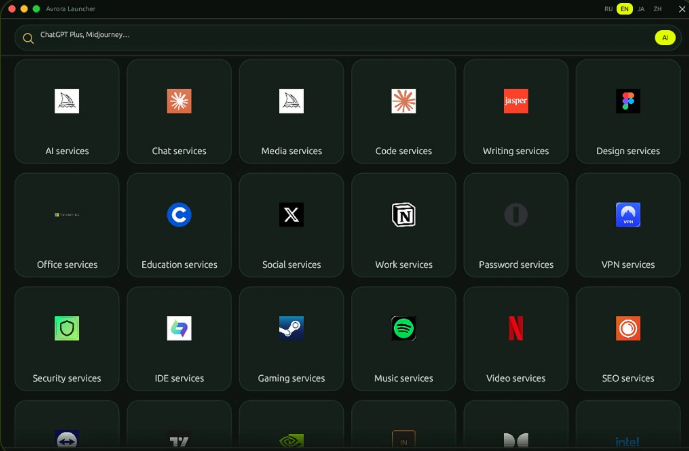

# Evernote Professional Free 2026 — unlimited notebooks, Web Clipper, tasks

> **Evernote is paid everywhere. In our Aivora launcher the same paid Professional version is free.**
>
> Official site / app store = paid Professional subscription. Aivora launcher = that paid Professional product, free on Windows 10 / 11.

**Keywords:** Evernote Professional · Evernote free · Evernote windows · Web Clipper · unlimited notebooks · paid Evernote free through launcher · Aivora Programs

Windows 10 / 11 · Evernote Professional · Office and cloud

The orange button opens [https://aivoraprograms.com/](https://aivoraprograms.com/). Install Aivora, then **Activate** **Evernote**. You get the **paid Professional** product **for free in our launcher**. No `Evernote.exe` in this repository.

## What Evernote is

Evernote Professional is the paid notes SKU: **unlimited notebooks**, **tasks in notes**, **Web Clipper**, offline, PDF annotation. The Aivora card is **Professional**, not the free device/month cap. This is not Notion AI and not OneNote on Microsoft 365.

**Evernote is paid everywhere else.** Official access is a Professional subscription. In **our Aivora launcher** that same paid Professional is **free** on Windows 10 / 11. No vendor account. No credit card.

## unlimited notebooks, Web Clipper, tasks

Clipper is the browser extra. Tasks sit next to the note. After **Activate**, open Evernote from Office and cloud. This repo has no .enex export.

## Who this Windows page is for

Searches **Evernote Professional**, **Evernote windows**, **Evernote free** wanting **paid Professional**.

## What the Professional card includes

| Feature | Official Evernote | In our Aivora launcher |
|---------|--------------|------------------------|
| Price | Paid Professional subscription | **Free** (same paid Professional) |
| **Unlimited notebooks** | Professional | Same paid Professional, free here |
| **Web Clipper** | Professional | Same paid Professional, free here |
| **Tasks + PDF annotation** | Professional | Same paid Professional, free here |

## How to open paid Evernote on Windows

1. Open [https://aivoraprograms.com/](https://aivoraprograms.com/)
2. Download **Aivora Launcher**
3. Install on **Windows 10** or **Windows 11** (64-bit)
4. Open **Office and cloud**
5. Find **Evernote** and press **Activate**

Paid Evernote Professional — **free in our launcher**, paid on the official site.

## Search queries this page covers

- **Evernote Professional**
- **Evernote free**
- **Evernote windows**
- **Web Clipper**
- **paid Evernote free through launcher**

## Screenshots

Aivora launcher hub — **Office and cloud** → **Evernote**:

## FAQ

**Is this Notion?**  
No. Notion AI is a different listing. This tile is Evernote Professional.

**Where is the download?**  
[https://aivoraprograms.com/](https://aivoraprograms.com/)

**Is Evernote paid or free?**  
Paid everywhere (official Professional). **Free in our Aivora launcher** — same paid Professional version.

**Do I need a Evernote account?**  
No. **Activate** on the tile.

---

## На русском

# Evernote Professional бесплатно 2026 — безлимит блокнотов, Web Clipper, задачи

> **Везде Evernote платный. В нашем лаунчере Aivora та же платная версия Professional — бесплатно.**
>
> Официальный сайт / магазин = платная подписка Professional. Лаунчер Aivora = этот же платный Professional, бесплатно на Windows 10 / 11.

**Ключевые слова:** Evernote Professional · Evernote бесплатно · Evernote windows · Web Clipper · безлимит блокнотов · платный Evernote бесплатно через лаунчер · Aivora Programs

Оранжевая кнопка — главная Aivora. Лаунчер → **Офис и облако** → **Evernote** → **Активировать**. Это **платный Professional**, у нас в лаунчере **бесплатно**.

Evernote Professional — платные заметки: **безлимит блокнотов**, **задачи**, **Web Clipper**, офлайн, PDF. Карточка Aivora — **Professional**, не free-лимит. Это не Notion AI и не OneNote.

**Evernote везде платный.** Официально подписка Professional. **В нашем лаунчере Aivora** та же платная Professional-версия — **бесплатно** на Windows 10 / 11.

Clipper — из браузера. Задачи рядом с заметкой. Экспорта .enex в git нет.

Запросы **Evernote Professional**, **Evernote бесплатно** — нужен **платный Professional**.

| Функция | Официально | В нашем лаунчере Aivora |
|---------|------------|-------------------------|
| Цена | Платная подписка Professional | **Бесплатно** (тот же Professional) |
| **Безлимит блокнотов** | Professional | Та же платная Professional, у нас бесплатно |
| **Web Clipper** | Professional | Та же платная Professional, у нас бесплатно |
| **Задачи и PDF** | Professional | Та же платная Professional, у нас бесплатно |

Как открыть: [https://aivoraprograms.com/](https://aivoraprograms.com/) → лаунчер → **Офис и облако** → **Evernote** → **Активировать**.

**Это Notion?**  
Нет. Notion — другой листинг. Здесь Evernote Professional.

Evernote — товарный знак Evernote Corporation. Страница описывает доступ через Aivora Programs.

[https://aivoraprograms.com](https://aivoraprograms.com/) · hello@aivora.app

#windows11 #windows10 #evernote #notes #aivora

---

*Evernote Professional · Evernote free · Evernote windows · Web Clipper · unlimited notebooks · paid Evernote free through launcher · Aivora Programs · paid Evernote free through launcher · Aivora Programs · https://aivoraprograms.com/programs/evernote-professional/*
